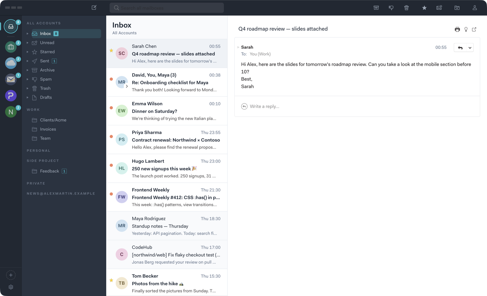
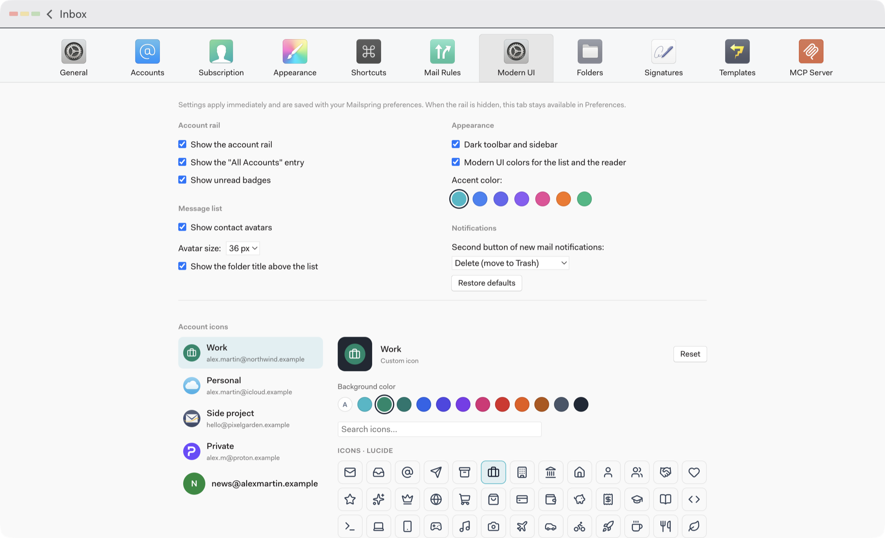
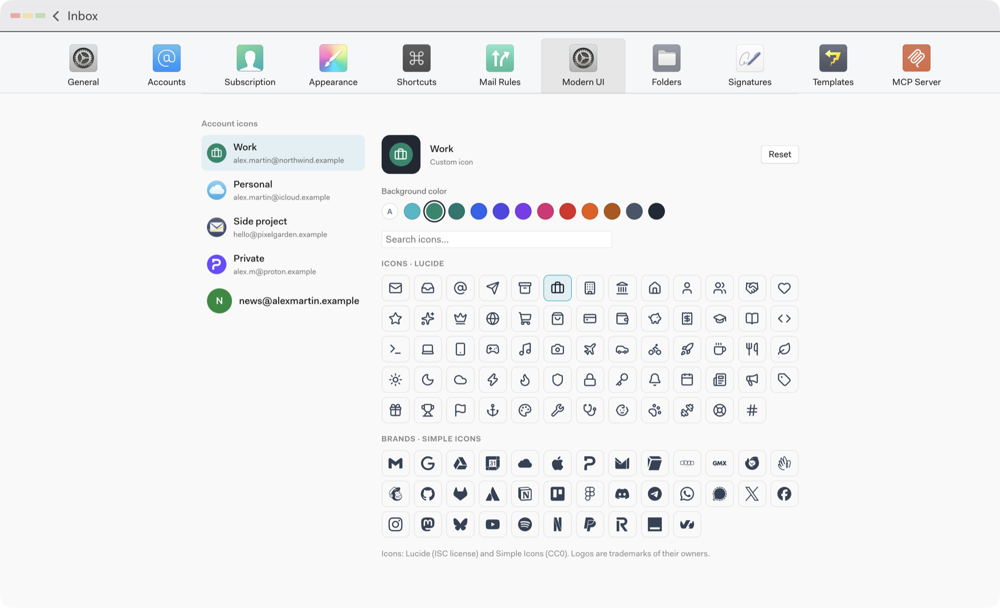

# Modern UI for Mailspring

A plugin for the **official Mailspring build** (tested with 1.26.2 on macOS)
that gives the interface an Airmail-inspired look: no fork, no recompiling,
no changes to the app bundle, and no separate theme.

```
[Account rail][Folders][Message list][Reader]
```



<table>
  <tr>
    <td></td>
    <td></td>
  </tr>
</table>

Screenshots use a demo profile with fictional accounts and messages.

Based on the official
[Mailspring-Plugin-Starter](https://github.com/Foundry376/Mailspring-Plugin-Starter),
with the same packaging: `src/` compiled by `tsc` into `lib/`, `styles/` loaded
by Mailspring, and a `package.json` declaring `engines.mailspring` and
`windowTypes`.

## Features

| # | Feature | Status | How |
|---|---|---|---|
| A | Vertical account rail | ✅ | Component injected into the `RootSidebar` column; navigation through `Actions.focusDefaultMailboxPerspectiveForAccounts` (same as Cmd+1…9) |
| B | Contact avatars in the message list | ✅ | `ThreadListIcon` role, the thread list's official extension point |
| C | Dynamic folder title | ✅ | Component injected into the `ThreadList` column, reads `FocusedPerspectiveStore` |
| D | "Delete" instead of "Archive" in new-mail notifications | ✅ with safeguards | Replaces the internal `unread-notifications` package's `Notifier` instance with a subclass (nothing is patched) |
| — | Dark/light palette, accent colors | ✅ | `styles/chrome.less`, `styles/content.less`, `styles/accents.less`, each switchable |
| — | Settings | ✅ | Native Preferences › Modern UI tab (`PreferencesUIStore`), ⚙ button in the rail |
| — | Per-account icons | ✅ | 64 Lucide icons and 36 Simple Icons logos bundled, 12 background colors |

### A. Account rail
- 64 px wide, `#202833` background, to the left of the native folder sidebar
  and inside the same column, so the toolbar, the macOS window controls and
  column resizing stay native.
- An "All Accounts" entry (with more than one account), then one round icon
  per account.
- Account icon: the one chosen in Preferences › Modern UI › Account icons;
  otherwise the provider logo **already bundled with Mailspring** (Gmail,
  Outlook, Office 365, iCloud, Yahoo, Fastmail, GMX, Yandex, Exchange);
  otherwise initials on a deterministic color, or on the color set in
  Preferences › Accounts. Nothing is downloaded.
- Selection indicator (edge bar and ring in the accent color), hover and
  keyboard focus states.
- Tooltip with the account label and address.
- Badge with the inbox unread count (the total for "All Accounts"), capped at 99+.
- Follows accounts being added or removed, account and folder changes, and
  unread counts; scrolls discreetly when there are more accounts than fit.
- "+" button (add an account), ⚙ button (plugin settings) and a context menu
  (add account, manage accounts, plugin settings).
- The native account-switcher arrow is hidden since the rail replaces it; its
  commands remain available from the rail. In the "All Accounts" view the
  sidebar keeps Mailspring's unified folders, which are needed.

### B. Avatars
- Circles of 28, 32, **36** or 40 px (setting), vertically centered; capped at
  26 px in the single-line list layout.
- Contact shown: the most recent sender who is not you; if every message is
  yours (Sent), the first recipient; otherwise the first participant. Drafts
  are ignored. The avatar only changes when a new message arrives.
- Photo: only a photo **stored locally** in the address book (CardDAV vCard
  with an embedded PHOTO). Remote photos (Google, URLs) are never loaded.
  Lookups are batched into one local SQLite query per frame and cached.
- Otherwise initials (name, or the local part of the address) on a soft
  background with darker text of the same hue; an address always gets the
  same color.
- Read and unread rows have the same geometry.

### C. Folder title
- 22 px, weight 650, `#1F2937`, on the list background, just below the toolbar.
- The folder's real name (custom names kept). For the unified view and
  `INBOX`, Mailspring's translated label (e.g. "Inbox"). During a search,
  "Search Results" and the query.
- Subtitle: the current account, or "All Accounts".

### D. Notifications
- Notifications stay Mailspring's own (same API, sound, quick reply, "N new
  messages" grouping, closing when the thread is read).
- The second button becomes "Delete" and calls
  `TaskFactory.tasksForMovingToTrash`: the message **moves to the Trash** of
  the right account, never a permanent deletion. "Mark as Read" is unchanged.
- If the account has no Trash folder, the notification keeps "Archive".
- If Mailspring's internals do not match what the plugin expects, the feature
  stays off and the stock notifications are left in place.

## Installation (macOS)

### From a release (recommended)

1. Download `mailspring-modern-ui-<version>.zip` from the
   [Releases](https://github.com/simokhalil/mailspring-modern-ui/releases)
   page (a `.sha256` checksum is attached).
2. Unzip it: you get a `mailspring-modern-ui` folder.
3. In Mailspring: **Mailspring › Install a Plugin…**, then select that folder.
4. Quit Mailspring (Cmd+Q) and reopen it.

### From the source

Requires Node.js 18 or later and npm.

```bash
git clone https://github.com/simokhalil/mailspring-modern-ui.git
```

```bash
cd mailspring-modern-ui
```

```bash
sh scripts/install.sh
```

The script installs the development dependencies, compiles `src/` into `lib/`,
checks the styles with Mailspring's own LESS compiler version (3.13.1),
checks the package, then **asks for confirmation** before copying the
distribution files (see below) into:

```
~/Library/Application Support/Mailspring/packages/mailspring-modern-ui
```

Then quit Mailspring (Cmd+Q) and reopen it. For development,
`sh scripts/install.sh --link` creates a symbolic link instead: after
`npm run build`, use Developer › Reload in the main window.

## Uninstalling

```bash
sh scripts/uninstall.sh
```

or delete `~/Library/Application Support/Mailspring/packages/mailspring-modern-ui`,
then restart Mailspring. The plugin changes no Mailspring file and the
notification change only lives in memory. Settings you changed are kept in
Mailspring's `config.json` under the `mailspring-modern-ui` key; they are
inert without the plugin and can be removed from that file.

## Settings

**Mailspring › Preferences › Modern UI**: a tab added through Mailspring's
public `PreferencesUIStore` API, like the bundled Signatures or MCP tabs. Also
reachable from the ⚙ button at the bottom of the rail and from its context
menu; the tab stays available when the rail is turned off.

| Section | Setting | Values (default in bold) |
|---|---|---|
| Account rail | Show the account rail | **on** / off |
| | Show the "All Accounts" entry | **on** / off |
| | Show unread badges | **on** / off |
| Message list | Show contact avatars | **on** / off |
| | Avatar size | 28 / 32 / **36** / 40 px |
| | Show the folder title | **on** / off |
| Appearance | Dark toolbar and sidebar | **on** / off |
| | Modern UI colors for the list and the reader | **on** / off |
| | Accent color | **turquoise**, blue, indigo, violet, pink, orange, green |
| Notifications | Second button | **Delete (move to Trash)** / Archive (Mailspring default) |
| Account icons | Icon and background color, per account | **automatic** (provider logo, else initials) |

Every change applies immediately, without restarting. Values are stored by
Mailspring's configuration system (`AppEnv.config`, validated against the
schema the plugin exports) in `config.json`, under `mailspring-modern-ui`.
"Restore defaults" clears them. Mailspring's own preferences are not changed.
The plugin's text follows Mailspring's language (English and French).

### Account icons

At the bottom of the tab: the account list on the left; on the right, a
preview (on a piece of rail, at actual size), the background colors ("A" =
automatic: the brand color for a logo, the account color otherwise), a search
field (names and English or French keywords, accents ignored) and the two
icon grids. Each click applies to the rail immediately; "Reset" goes back to
the automatic icon.

Choices are stored by Mailspring account id (not by position) in
`mailspring-modern-ui.accountIcons`:

```json
"accountIcons": {
  "account-id-1": { "icon": "briefcase", "source": "lucide", "backgroundColor": "#04876A" },
  "account-id-2": { "icon": "gmail", "source": "simple-icons" }
}
```

- Mailspring accounts themselves are not modified.
- An icon that no longer exists (removed in a later plugin version) falls back
  to the automatic icon and keeps the chosen color.
- A deleted account disappears from the list; its entry is cleaned up the next
  time an icon is changed. A new account gets the automatic icon.
- Simple Icons no longer includes brands removed at their owners' request
  (Microsoft/Outlook, Yahoo, Slack, LinkedIn, Amazon…). For Outlook and Yahoo
  accounts, Mailspring's bundled logo remains the automatic icon.

### Notes
- With the "All Accounts" entry hidden, the unified view is still available
  with Cmd+1 or the Window menu.
- If the installed Mailspring version does not allow changing notifications,
  the setting is greyed out with an explanation.
- The tab uses the generic Preferences icon: Mailspring only looks up tab
  icons in its own resources.
- Settings keys from earlier versions (`theme`, `notificationDeleteAction`,
  `accountIconStyle`) are ignored; they were replaced by `darkChrome` /
  `lightContent`, `notificationAction` and `accountIcons`.

## What is distributed

A Mailspring user needs these files, listed once in `scripts/dist-files.sh`
and used by both `install.sh` and `pack.sh`:

| Path | Why |
|---|---|
| `package.json` | Name, entry point (`main`), `engines.mailspring` (required for Mailspring to activate the plugin), `windowTypes`, `syncInit` |
| `lib/` | Compiled JavaScript; Mailspring does not compile TypeScript |
| `styles/` | LESS, compiled by Mailspring itself |
| `LICENSE` | The plugin's MIT license |
| `THIRD_PARTY_NOTICES.md`, `licenses/` | Required by the bundled icons' licenses; trademark notice for the logos |
| `README.md` | Installation and settings |

`src/`, `types/`, `test/`, `scripts/`, `tsconfig.json` and `package-lock.json`
are for development only. `lib/` is committed, as the official starter
recommends, so a clone of the repository can also be installed directly.

## Releases

Pushing a tag publishes a GitHub release through
`.github/workflows/release.yml`:

- `v1.2.0`: a regular release;
- a tag containing `beta`, such as `v1.3.0-beta.1`: a **pre-release**.

The tag must match the `version` field of `package.json` (`1.3.0-beta.1` for
the example above). The workflow installs the dependencies, runs
`npm run verify` (clean build, LESS check, tests, package check), fails if the
committed `lib/` differs from a fresh build, then attaches the archive built
by `scripts/pack.sh` (one `mailspring-modern-ui/` folder) and its SHA-256
checksum. To build the same archive locally: `npm run pack` (output in `dist/`).

## Project structure

```
package.json            main ./lib/main, engines.mailspring, windowTypes, syncInit
src/main.ts             activate/deactivate, turns each feature on and off
src/settings.ts         settings schema (exported as `config`), read/write helpers
src/i18n.ts             the plugin's own strings (English, French)
src/icons/icon-data.ts  bundled icons, GENERATED by scripts/build-icons.js
src/components/         AccountRail, AccountIcon, RailTooltip, Avatar, ThreadAvatar,
                        FolderTitle, SettingsTab (Preferences tab),
                        AccountIconsEditor, AccountAvatar, IconGlyph
src/services/           account navigation, avatar contact choice, initials/colors,
                        vCard photos, photo cache, folder title, column width,
                        accents, account icons, notifications
styles/index.less       entry point loaded by Mailspring (+ partials: rail, account
                        icons, avatars, title, accents, dark chrome, light content, tab)
lib/                    compiled JavaScript, distributed
types/mailspring/       TypeScript declarations for the Mailspring APIs used
test/                   tests (node:test) against a simulated Mailspring runtime
scripts/                install.sh, uninstall.sh, pack.sh, dist-files.sh,
                        verify-package.js, build-icons.js
licenses/               full license texts of Lucide and Simple Icons
THIRD_PARTY_NOTICES.md  icon credits, licenses and trademark notice
docs/compatibility.md   Mailspring APIs used, internal details, risks
.github/workflows/      release workflow
```

React is not bundled: the plugin uses Mailspring's own copy through
`mailspring-exports` (`react`, `react-dom` and `react-test-renderer` are only
used by the tests). No `node_modules` are needed at runtime.

## Icon licenses

- **Lucide**: ISC License; some icons derive from Feather and are also under
  the MIT License. Full text in `licenses/lucide-LICENSE.txt`.
- **Simple Icons**: CC0 1.0 Universal. Full text in
  `licenses/simple-icons-LICENSE.md`. Every logo remains a trademark of its
  owner and is included only so users can recognise their accounts; brand
  guidelines are linked from `THIRD_PARTY_NOTICES.md`.
- Only the 100 icons listed in `scripts/build-icons.js` are copied (72 KB of
  source); both libraries are development dependencies, never loaded at
  runtime. To change the selection, edit the lists and run `npm run icons`,
  which also refreshes `THIRD_PARTY_NOTICES.md` and `licenses/`.

## Development

```bash
npm install
```

```bash
npm run verify
```

`verify` runs a clean build, the LESS check (Less 3.13.1), the tests and the
package check.

## Testing

| Check | Result |
|---|---|
| `tsc` (TypeScript 5.9, no unused locals) | ✅ no errors |
| LESS compiled with Less 3.13.1, the version bundled with Mailspring 1.26.2 | ✅ |
| `scripts/verify-package.js`: name, `engines`, `windowTypes`, entry point, exports, `lib/` up to date, no `require` outside the Mailspring runtime, distribution and license files present | ✅ |
| 42 `node:test` tests: pure services (including icons: bundled set, resolution and fallbacks, search, persistence); 19 that load `lib/` against a simulated Mailspring runtime (registration, React 17 rendering, navigation, stores, unsubscribing, live settings, Preferences tab, icon editor, notifications); 3 that compile the LESS | ✅ 42/42 |
| `install.sh` / `uninstall.sh` against a temporary folder (cancel, copy, remove) | ✅ |
| Loaded in Mailspring 1.26.2 on macOS | ✅ active, no console errors |

There is no automated test in a second Mailspring instance: an empty profile
shows no main window without an account, and a test profile would share the
macOS keychain of the main installation. Visual checks are done in a real
installation.

## Manual checks in Mailspring

1. Install and restart Mailspring. Developer › Toggle Developer Tools: no
   `mailspring-modern-ui` error in the console; about a second after launch
   the line `notifications: "Archive" replaced with "Delete"` appears.
2. **Rail**: one entry per account, plus "All Accounts" with several accounts.
   Accounts whose provider Mailspring has a logo for show it; others show
   initials. Clicking an account shows only its folders and opens its inbox,
   and the indicator follows. Cmd+1…9 also moves the indicator. Tooltips on
   hover. Resize the sidebar; check the window controls and the toolbar.
3. **Avatars**: in the split view and the list layout (View › Layout), in the
   Inbox, Sent (recipient's avatar), Drafts and a mailing list. Scroll a long
   list quickly: it stays smooth.
4. **Title**: change folders and accounts, open a custom folder, run a
   search, go back to "All Accounts".
5. **Notifications**: send yourself a message from another account with
   Mailspring in the background. In System Settings › Notifications ›
   Mailspring, choose the "Alerts" style to see the buttons. "Delete" moves
   the message to the right account's Trash.
6. **Settings**: Preferences › Modern UI (or ⚙ in the rail). Changing the
   accent, the avatar size or hiding "All Accounts" applies immediately.
   With the rail turned off, the tab stays in Preferences. Unchecking both
   Appearance options restores the original colors immediately. Account icons:
   pick an icon and a color for an account and the rail updates at once;
   restart Mailspring and the choice is kept; "Reset" restores the automatic icon.
7. **Uninstall**: uninstall and restart: the native interface is back.

## Limitations

- **Sidebar width**: the column grows by the rail's width, so the folder list
  keeps its native range (165 to 250 px). This goes through the width
  declaration of Mailspring's `AccountSidebar` component (see
  docs/compatibility.md).
- **Hidden sidebar** (View › Hide Sidebar): the rail is hidden with it, since
  they share a column.
- **Contact photos**: only photos embedded in CardDAV vCards. Google contacts
  (remote photos) and accounts without an address book get initials. This is
  deliberate: no network requests.
- **Split view**: Mailspring renders one injected icon per row; other
  plugins' icons (open tracking…) are redrawn as a small chip on the avatar.
- **Notifications**: depend on the internal `unread-notifications` package (see
  docs/compatibility.md). macOS shows action buttons only with the "Alerts"
  style, or under "Options" on hover with "Banners", as for the stock
  notifications. Five or more new messages are grouped without buttons
  (Mailspring's behavior).
- **Theme**: written on top of Mailspring's base styles and the ui-darkside
  theme, and checked on screen with ui-darkside. With a dark theme, turn off
  "Modern UI colors for the list and the reader".
- **Future versions**: Mailspring's `master` branch adds a native navigation
  rail; see docs/compatibility.md.

## License

MIT, see `LICENSE`. Bundled icons: see `THIRD_PARTY_NOTICES.md`.
